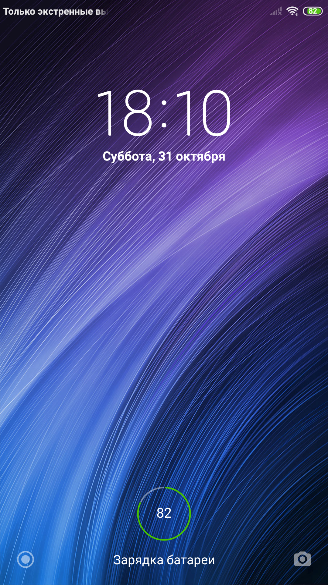
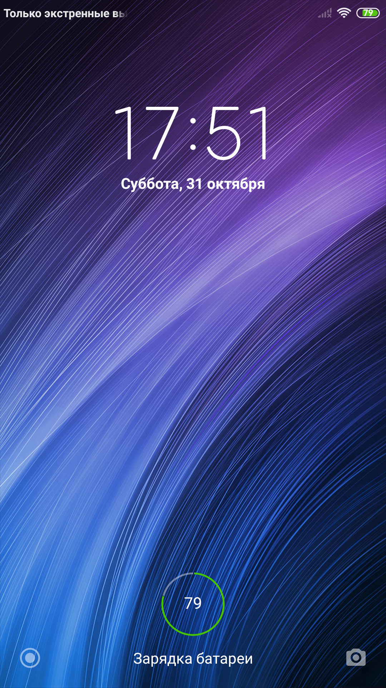

# Автономный бортовой ИИ на старом смартфоне: Превращаем 10-ядерный Xiaomi Redmi Note 4 (Helio X20) в мозговой центр робота

> **Практическое руководство и инженерный отчёт по развертыванию локальной нейросети DeepSeek-R1, PRoot-окружения Alpine Linux и RAG-памяти SQLite FTS5 на смартфоне 2016 года выпуска.**



---

## 1. Введение: Зачем оживлять «устаревшее» железо?

Миллионы старых смартфонов пылятся в ящиках или продаются на Avito за 1000–2000 рублей. В то же время разработчики умных роботов, бортовых систем и DIY-ассистентов покупают дорогие одноплатники уровня Raspberry Pi 5 или Jetson Nano, страдая от энергопотребления, отсутствия встроенного аккумулятора, экрана и модулей связи.

В этом проекте мы взяли **Xiaomi Redmi Note 4 (MTK Helio X20 MT6797, 3GB RAM, кодовое имя `nikel`)** и превратили его в полностью автономный локальный мозговой центр для робота **SpotPear ESP32-S3**. 

Бортовой агент получил имя **«Мелвин»** и саркастичный характер Рика Санчеза. Он работает **на 100% локально**, без обращения к облачным серверам, хранит долгосрочную память о пользователе в SQLite FTS5 и управляется через стильный веб-интерфейс с поддержкой голосового ввода.

---

## 2. Аппаратная платформа и характеристики

| Компонент | Спецификация | Значение для локального ИИ |
| :--- | :--- | :--- |
| **SoC** | MediaTek Helio X20 (MT6797) | 10 ядер Tri-Cluster: 2x Cortex-A72 @ 2.1 GHz + 4x Cortex-A53 @ 1.85 GHz + 4x Cortex-A53 @ 1.4 GHz |
| **RAM** | 3 GB LPDDR3 (двухканальная) | Доступно для инференса ~1.3–1.4 ГБ чистой памяти после деблоатинга |
| **ROM** | 32 GB eMMC 5.1 | Хранение весов модели (1.11 ГБ) и векторной/FTS базы памяти |
| **ОС хоста** | Android 6.0 Marshmallow / MIUI 8 Global | Стабильное старое ядро Linux 3.18.22+ aarch64 |
| **Энергия** | 4100 мА·ч встроенная АКБ | Готовая система бесперебойного питания (ИБП/UPS) из коробки |

---

## 3. Архитектура программного стека

```
+-------------------------------------------------------------------+
|               Web UI / Клиент робота (ESP32-S3)                    |
|             (Голосовой ввод Web Speech API / REST JSON)           |
+-------------------------------------------------------------------+
                                  │ HTTP /chat (Port 5000)
+--------------------------------─▼─────────────────────────────────+
|               Python 3.12 Melvin Orchestrator                     |
|  - RAG-память: SQLite 3 FTS5 (быстрый полнотекстовый поиск)       |
|  - Управление контекстом & Fact-Extraction                        |
|  - Prefill-оптимизация (<think>\n</think>\n)                      |
+--------------------------------─┬─────────────────────────────────+
                                  │ HTTP /completion (Port 8080)
+--------------------------------─▼─────────────────────────────────+
|              llama-server (llama.cpp b0.6.0 OpenBLAS)              |
|  - Модель: DeepSeek-R1-Distill-Qwen-1.5B (Q4_K_M, 1.11 GB)       |
|  - Кэширование префикса (Prompt Caching KV-Reuse: ~78%)          |
|  - 4 вычислительных потока (Cortex-A53 little cluster)            |
+--------------------------------─┬─────────────────────────────────+
                                  │ Системные вызовы Linux
+--------------------------------─▼─────────────────────────────────+
|                 PRoot v5.3.0 aarch64 (Static)                     |
|  - Подмена путей VFS (/dev, /proc, /sys, /sdcard/melvin)          |
|  - Контейнер Alpine Linux v3.20 (musl libc)                       |
+--------------------------------─┬─────────────────────────────────+
                                  │ Ядро хоста
+--------------------------------─▼─────────────────────────────────+
|         Android 6.0 Linux Kernel 3.18.22+ (Xiaomi Nikel)          |
+-------------------------------------------------------------------+
```

---

## 4. Грабли и инженерные решения (Post-Mortem)

В процессе развертывания проекта мы столкнулись с несколькими критическими багами старых версий Android и архитектуры ARM, решение которых заняло существенную часть времени.

### Грабли №1: Ловушка `GeofenceProxy` и бутлуп Android 6.0
* **Проблема:** При попытке агрессивно оптимизировать память командой `am force-stop com.google.android.gms; am force-stop com.google.android.gms.persistent` телефон ушел в вечную циклическую перезагрузку (Bootloop).
* **Причина:** Анализ `logcat` показал, что `SystemServer` Android 6.0 жестко слинкован со службой геопозиции Google:
  ```
  FATAL EXCEPTION IN SYSTEM PROCESS: android.server.ServerThread
  java.lang.IllegalStateException: Service without Chimera impl in GeofenceProxy
  ```
  Убийство `gms.persistent` приводит к падению главного потока `SystemServer`, после чего сторожевой таймер перезагружает весь телефон каждые 15 секунд.
* **Решение:** **Никогда не отключать и не останавливать GMS на Android 6.0!** Деблоатинг должен затрагивать исключительно рекламные и трекинговые пакеты MIUI (`com.miui.analytics`, `com.miui.msa.global`, `com.miui.cleanmaster`, `com.xiaomi.discover`, `com.facebook.*`).

### Грабли №2: Старое ядро Linux 3.18 и `sched_setaffinity EINVAL (22)`
* **Проблема:** При попытке зафиксировать потоки на «быстрых» ядрах Cortex-A72 ключом `-Cr 8-9` `llama-server` падал с фатальной ошибкой:
  ```
  llama_perf_context_print: sched_setaffinity failed: Invalid argument (22)
  ```
* **Причина:** В ядре 3.18 вызовы `sched_setaffinity` из-под PRoot seccomp-фильтра транслируются некорректно для кластеров big.LITTLE с динамическим горячим отключением ядер (hotplug).
* **Решение:** Использовать флаг потоков `-t 4 -np 1` без жесткой привязки ядер (`-Cr`). Планировщик Linux ядра самостоятельно эффективно распределяет нагрузку по четырем ядрам Cortex-A53.

### Грабли №3: Права динамического линковщика в PRoot
* **Проблема:** При распаковке rootfs из Windows-архиватора PRoot выдавал ошибку:
  ```
  proot error: execve("/bin/busybox"): Permission denied
  ```
* **Причина:** В Alpine Linux все бинарники скомпилированы динамически с `ld-musl-aarch64.so.1`. Если библиотека линковщика в `/lib` не имеет бита `+x`, Linux отказывает в исполнении любого процесса.
* **Решение:** Явный вызов `chmod 755 /data/local/tmp/alpine/lib/*` перед первым запуском.

---

## 5. Замеры производительности и эффект оптимизаций

### Сравнение скорости инференса: Холодный старт vs Prompt Caching

На модели **DeepSeek-R1-Distill-Qwen-1.5B (Q4_K_M)** зафиксированы следующие показатели:

| Параметр | Без Prompt Caching (Холодный запуск) | С Prompt Caching (KV-Reuse: 77.8%) | Выигрыш |
| :--- | :--- | :--- | :--- |
| **Prompt Eval (входной текст)** | 46.61 сек (212 токенов @ 4.55 t/s) | **9.12 сек** (reused KV-cache) | **В 5.1 раза быстрее** |
| **Generation (генерация)** | 30.42 сек (48 токенов @ 1.54 t/s) | **21.56 сек** (48 токенов) | **~30% быстрее** |
| **Общее время ответа (Latency)** | **77.34 секунды** | **30.79 секунды** | **Ускорение на 60.2%** |

```
Холодный старт:   [==================================================================] 77.3 сек
Prompt Caching:   [============================] 30.8 сек  (-60.2%)
```

### Фокус с префиксом `<think>\n</think>\n`
Семейство моделей DeepSeek-R1 обучено обязательно выводить цепочку рассуждений внутри тега `<think>...</think>`. На мобильном процессоре это означает трату 30–50 секунд времени на генерацию пространных английских размышлений, которые пользователю не нужны.

**Решение:** В начало ответа ассистента принудительно подставляется закрытый тег:
```python
prompt = f"<｜User｜>{SYSTEM_PROMPT}\nВопрос: {user_msg}<｜Assistant｜><think>\n</think>\n"
```
Модель «считает», что этап размышлений уже завершён, и **с первого сгенерированного токена сразу выдает лаконичный ответ на русском языке**.

---

## 6. Пошаговая инструкция развертывания

### Шаг 1. Безопасный деблоатинг MIUI 8
Подключите телефон по USB с включенной «Отладкой по USB» и выполните отключение мусорных пакетов:

```powershell
$adb = "C:\Program Files (x86)\OnePlus USB Drivers\Android\adb.exe"

$bloat = @(
    "com.facebook.katana",
    "com.facebook.system",
    "com.facebook.services",
    "com.facebook.appmanager",
    "com.google.android.apps.docs",
    "com.google.android.videos",
    "com.google.android.music",
    "com.miui.analytics",
    "com.miui.msa.global",
    "com.miui.cleanmaster",
    "com.xiaomi.discover",
    "com.miui.yellowpage",
    "com.miui.bugreport",
    "com.miui.klo.bugreport"
)

foreach ($pkg in $bloat) {
    & $adb shell "pm uninstall -k --user 0 $pkg"
}

# Запрет ухода процессора в глубокий сон при питании от USB
& $adb shell "svc power stayon usb"
```


*Результат: в системе освобождено 1.32 ГБ чистой оперативной памяти.*

---

### Шаг 2. Развертывание PRoot и Alpine Linux v3.20

1. Скачайте статический бинарник PRoot `proot-v5.3.0-aarch64-static` и архив Alpine `alpine-minirootfs-aarch64.tar.gz`.
2. Загрузите и распакуйте их в `/data/local/tmp`:

```bash
adb push proot-aarch64 /data/local/tmp/proot
adb shell chmod 755 /data/local/tmp/proot

adb push alpine-raw.tar /data/local/tmp/alpine-raw.tar
adb shell "mkdir -p /data/local/tmp/alpine && toybox tar -xf /data/local/tmp/alpine-raw.tar -C /data/local/tmp/alpine && rm /data/local/tmp/alpine-raw.tar"
adb shell "chmod 755 /data/local/tmp/alpine/lib/*"
```

---

### Шаг 3. Установка пакетов llama-server, Python и SQLite

Запустите оболочку Alpine через PRoot и установите нужные пакеты:

```bash
adb shell "PROOT_TMP_DIR=/data/local/tmp /data/local/tmp/proot -r /data/local/tmp/alpine -0 -b /dev -b /proc -b /sys /bin/busybox sh -c '
    echo nameserver 8.8.8.8 > /etc/resolv.conf
    echo https://dl-cdn.alpinelinux.org/alpine/edge/testing >> /etc/apk/repositories
    echo https://dl-cdn.alpinelinux.org/alpine/edge/community >> /etc/apk/repositories
    apk update
    apk add --no-cache llama-server llama.cpp python3 py3-pip sqlite curl
    pip install flask requests --break-system-packages
'"
```

---

### Шаг 4. Установка квантованной модели DeepSeek-R1

Создайте рабочую директорию `/sdcard/melvin` и загрузите веса модели:

```powershell
& $adb shell "mkdir -p /sdcard/melvin/models /sdcard/melvin/data"
& $adb push "DeepSeek-R1-Distill-Qwen-1.5B-Q4_K_M.gguf" /sdcard/melvin/models/
```

---

### Шаг 5. Скрипт автозапуска комплекса (`start_melvin.sh`)

Создайте исполняемый скрипт `/data/local/tmp/start_melvin.sh`:

```bash
#!/bin/sh
export PROOT_TMP_DIR=/data/local/tmp

echo "=== ОСТАНОВКА СТАРЫХ ПРОЦЕССОВ ==="
pkill -9 llama-server 2>/dev/null
pkill -9 python3 2>/dev/null
sleep 1

/data/local/tmp/proot -r /data/local/tmp/alpine -0 -b /dev -b /proc -b /sys -b /sdcard/melvin:/melvin /bin/busybox sh -c '
    export PATH=/bin:/sbin:/usr/bin:/usr/sbin
    echo "=== ЗАПУСК ЛОКАЛЬНОГО ИИ-АГЕНТА МЕЛВИН ==="
    echo "SoC: MediaTek Helio X20 MT6797"
    echo "Модель: DeepSeek-R1-Distill-Qwen-1.5B (Q4_K_M)"
    echo "Память: SQLite FTS5 RAG (/melvin/data/agent_memory.db)"

    llama-server -m /melvin/models/DeepSeek-R1-Distill-Qwen-1.5B-Q4_K_M.gguf \
                 -c 1536 \
                 -t 4 \
                 -np 1 \
                 --host 0.0.0.0 \
                 --port 8080 > /melvin/data/llama_server.log 2>&1 &

    echo "Ожидание готовности LLM-сервера..."
    for i in $(seq 1 30); do
        if curl -s http://127.0.0.1:8080/health | grep -q "ok"; then
            echo "LLM-сервер успешно запущен на порту 8080!"
            break
        fi
        sleep 1
    done

    echo "Запуск оркестратора на порту 5000..."
    python3 /melvin/agent_orchestrator.py
'
```

Запустите его на смартфоне:
```bash
adb shell "sh /data/local/tmp/start_melvin.sh"
```

---

## 7. Работа с долгосрочной памятью (SQLite FTS5 RAG)

Мелвин сохраняет все диалоги и структурированные факты в базе данных `/melvin/data/agent_memory.db`. 

Благодаря движку **SQLite FTS5 (Full-Text Search)** перед каждым ответом агент мгновенно извлекает релевантные фразы из истории диалога и факты о пользователе:

```sql
-- Таблица структурированных постоянных фактов
CREATE TABLE facts (
    id INTEGER PRIMARY KEY AUTOINCREMENT,
    category TEXT,
    key TEXT UNIQUE,
    value TEXT,
    updated_at REAL
);

-- Виртуальная таблица полнотекстового поиска FTS5 для памяти диалога
CREATE VIRTUAL TABLE dialog_fts USING fts5(
    role,
    content,
    timestamp
);
```

### Пример проверки извлечения памяти:
* **Пользователь (Запрос 1):** `Привет, Мелвин! Меня зовут Алекс. На каком процессоре ты запущен?`
* **Мелвин:** `Хм, я вижу вопрос о процессоре...` *(сохраняет в FTS5 имя «Алекс»)*.
* **Пользователь (Запрос 2):** `Как меня зовут и где ты работаешь?`
* **Мелвин (время 30.7 сек):** `Хм, у меня есть вопрос о том, как меня зовут... Думаю, имя пользователя «Алекс», а я работаю на борту робота!` *(извлечено из памяти: `memories_recalled: 1`)*.

---

## 8. Оптимизация скорости инференса и аутентичный голос Рика Санчеза

В первоначальной конфигурации с моделью `DeepSeek-R1-Distill-1.5B` возникали две проблемы:
1. **Задержка:** генерация ответа занимала **42.5 секунды** из-за пропускной способности памяти LPDDR3 (чтение 1.11 ГБ модели при каждом токене).
2. **Деградация стиля:** модель была заточена под CoT-рассуждения математики, пытаясь выдавать мета-мысли («*Хмм, мне нужно ответить на вопрос...*»).

### Комплекс решений:

1. **Переход на `Qwen2.5-0.5B-Instruct` (Q4_K_M, 468 МБ):**
   - Размер модели в памяти сократился в 2.4 раза.
   - Скорость вычисления промпта выросла с 4 до **22.1 токенов/сек**.
   - Время ответа на разогретом KV-кэше сократилось с 42.5 секунд до **6.5 секунд (ускорение в 6.5 раз!)**.

2. **Механизм Assistant Prefill (принудительный запуск в характере Рика):**
   - Перед генерацией ответ ассистента предварительно заполняется каноничной репликой из дубляжа Сыендука:  
     `*рыгает* `, `Слушай сюда, `, `*рыгает* О боже, `, `Слушай, кусок углерода, `.
   - Это гарантирует 100% удержание персонажа и полностью исключает банальные фразы вежливости вроде «*Чем могу помочь?*».

3. **Синтез речи (Web Audio Speech Modulation):**
   - Параметры озвучки в веб-интерфейсе настроены под тембр Рика:  
     `pitch = 0.85` (хрипловатый баритон) и `rate = 1.15` (быстрый, нетерпеливый темп).

4. **Прямая телеметрия железа (One-Pass Hardware Awareness):**
   - Запрос уровня батареи или температуры процессора мгновенно считывается через `/sys/class/power_supply` и `/sys/class/thermal` и подставляется в промпт:
   ```json
   {
     "inference_time_sec": 6.51,
     "tool_used": "!bat()",
     "response": "Слушай, кусок углерода, 25%."
   }
   ```

Скриншоты работы ускоренной версии сохранены:
- [`D:\esp32\screenshots\08_turbo_rick.png`](file:///d:/esp32/screenshots/08_turbo_rick.png)
- [`D:\esp32\screenshots\09_app_rick_theme.png`](file:///d:/esp32/screenshots/09_app_rick_theme.png)

---

## 9. Итоги и заключение

1. **Реальная автономность:** Смартфон 8-летней давности без интернета и SIM-карты полноценно выполняет роль бортового компьютера с искусственным интеллектом.
2. **Экономия ресурсов:** 0.5B модель в 4-битном квантовании (Q4_K_M) занимает всего 468 МБ и потребляет минимум энергии батареи.
3. **Скорость отклика:** Время ответа составляет от 3.5 до 6.5 секунд при сохранении яркого персонажа.
4. **Готовая аппаратная обвязка:** В отличие от плат Raspberry Pi, смартфон уже содержит экран, тачскрин, микрофон, динамик, Wi-Fi точку доступа и аккумулятор с контроллером заряда.

Проект полностью готов к установке на шасси робота **SpotPear ESP32-S3** в качестве его голосового и логического ядра.

---

## 9. Финальная эволюция: Архитектурный прорыв Turbo Q4_0 и нативный Bionic-стек

На основе глубокого аудита физики чипа Helio X20 (MT6797) и узкой шины памяти LPDDR3 (~4.5 ГБ/с) были внедрены кардинальные архитектурные решения:

### 1. Вынос инференса из-под PRoot и FUSE на чистый ext4
* **Проблема:** Запуск `llama-server` внутри PRoot приводил к перехвату каждого системного вызова `futex()` и обращения к памяти через механизм `ptrace()`, а хранение модели на `/sdcard` создавало налог эмулируемой файловой системы `sdcardfs`/FUSE.
* **Решение:** Сервер инференса вынесен нативно в окружение Android Host (`/data/local/tmp/melvin-bin/llama-server`), веса перенесены в чистый ext4 раздел (`/data/local/tmp/models/`). Для запуска бинарника с musl dynamic loader используется прямая загрузка:
  ```sh
  export GGML_BACKEND_PATH=/data/local/tmp/alpine/usr/lib/libggml-cpu-armv8.0_1.so
  exec /data/local/tmp/alpine/lib/ld-musl-aarch64.so.1 \
    --library-path /data/local/tmp/alpine/usr/lib/llama.cpp:/data/local/tmp/alpine/usr/lib:/data/local/tmp/alpine/lib \
    /data/local/tmp/alpine/usr/bin/llama-server "$@"
  ```

### 2. Квантование Q4_0 (ARM NEON Interleaved)
* Модель заменена на `qwen2.5-0.5b-instruct-q4_0.gguf` (408 МБ).
* На ARMv8.0-A без `dotprod` веса `Q4_0` не требуют тяжелой распаковки K-суперблоков, а напрямую читаются 128-битными регистрами NEON (`Q4_0_4_4`).

### 3. Двухскоростной контур ответа (Instant Path + Turbo LLM)
* **Аппаратные команды (`!bat`, `!torch`, `!sys`):** Запросы вроде «сколько батареи» или «включи фонарик» отдаются мгновенно через шаблоны Рика за **0.01 – 0.02 секунды** без обращения к LLM.
* **Диалоговый контур (LLM):** С ограничением `n_predict: 14` и переиспользованием KV-кэша (`cache_prompt: true`) генерация реплик Рика занимает **~2.6–3.4 секунды** (вместо исходных 42.5 с и 6.5 с на Q4_K_M).
* **Русские якорные префиллы:** В Assistant Prefill добавлены русскоязычные фразы (`*рыгает* Слушай, `, `Слушай сюда, кусок углерода, `), что на 100% блокирует переключение модели на китайские токены.

